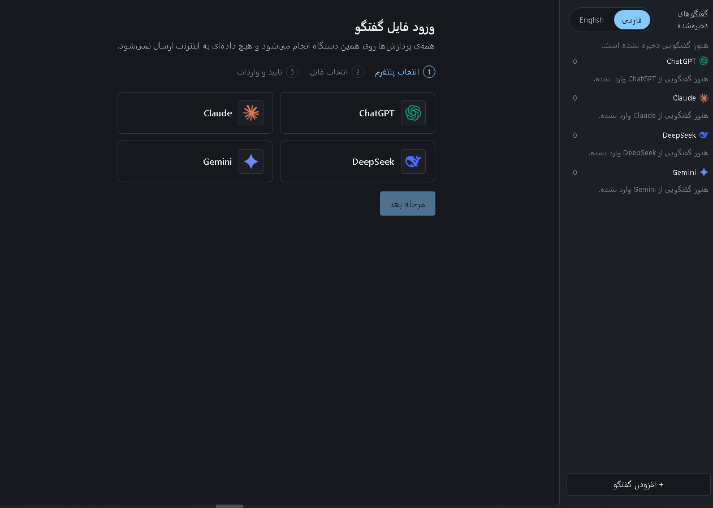
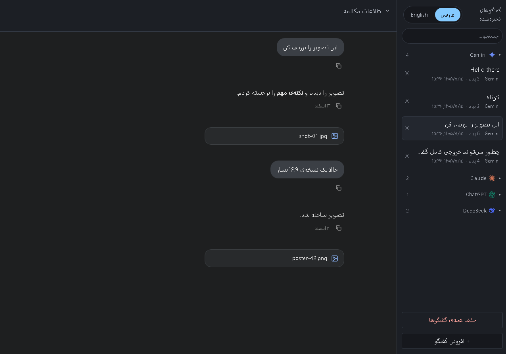

# Offline AI Conversation Viewer

[English 🇬🇧](./README.md)

یک اپلیکیشن وب **کاملاً آفلاین** برای Import، ذخیره‌سازی محلی، و نمایش اصیل (Authentic) مکالمات صادرشده از پلتفرم‌های AI Chat — بدون بک‌اند، بدون آپلود، بدون هیچ درخواست شبکه‌ای.

فایل JSON خامی که از یک پلتفرم AI Chat Export کرده‌اید را باز کنید و آن را دقیقاً با همان حس‌وحال بصری پلتفرم اصلی (رنگ، تایپوگرافی، حباب پیام، آیکون) مرور کنید — مثل یک کتابخانه‌ی شخصی از مکالمات.

---

## ⚠️ وضعیت فعلی پروژه

این پروژه با روش **Spec-Driven Development** و به‌صورت واحد‌به‌واحد (Unit-by-Unit) ساخته شده است. تمام واحدها (Import، Detection، Parsing، Library، Metadata، Theme Rendering، Search، و پشتیبانی چهار پلتفرم) **تکمیل و تست شده‌اند** — ChatGPT با Parser و Theme کامل ولی بر اساس فیکسچر مصنوعی، یعنی **Unverified** تا زمان آزمون با نمونه‌ی Export واقعی:

| پلتفرم | Parser | Theme اختصاصی | وضعیت |
|---|---|---|---|
| **DeepSeek** | ✅ | ✅ | کاملاً پشتیبانی می‌شود |
| **Claude** | ✅ | ✅ | کاملاً پشتیبانی می‌شود |
| **Gemini** | ✅ | ✅ | کاملاً پشتیبانی می‌شود |
| **ChatGPT** | ✅ | ✅ | پشتیبانی می‌شود، ولی **تأییدنشده** (Unverified — هنوز با نمونه‌ی Export واقعی آزمون نشده) |

**چرا ChatGPT تأییدنشده است؟** این پروژه اصل «هرگز ساختار داده یا ظاهر یک پلتفرم را حدس نزن» را جدی می‌گیرد. Parser و Theme سه پلتفرم DeepSeek، Claude و Gemini از نمونه‌ی Export واقعی ساخته شدند؛ ChatGPT فعلاً فقط با فیکسچر مصنوعیِ برگرفته از توصیف مالک پوشش داده شده و تا زمان آزمون با نمونه‌ی Export واقعی، **Unverified** می‌ماند. افزودن پلتفرم جدید، معماری موجود را تغییر نمی‌دهد — فقط یک ماژول جدید اضافه می‌کند (به بخش «افزودن پلتفرم جدید» در پایین مراجعه کنید).

---

## ✨ ویژگی‌ها

- **Import خودکار و بدون دخالت کاربر** — فایل JSON را Drag & Drop یا انتخاب کنید؛ پلتفرم مبدا به‌طور کاملاً خودکار تشخیص داده می‌شود (بدون هیچ گزینه‌ی انتخاب دستی).
- **کتابخانه‌ی محلی پایدار** — مکالمات در IndexedDB مرورگر ذخیره می‌شوند و بین بازدیدها باقی می‌مانند؛ بدون نیاز به Import مجدد.
- **تشخیص هوشمند تکراری** — Import مجدد یک فایل، رکورد تکراری نمی‌سازد؛ فقط یک خلاصه نمایش می‌دهد.
- **رندر اصیل هر پلتفرم** — ظاهر بصری (Layout، رنگ، فونت، حباب پیام) بازتولید همان پلتفرم است، بدون کپی هیچ کد یا Asset رسمی.
- **پنل متادیتا** — عنوان، تاریخ، تعداد پیام هر مکالمه (در صورت وجود در فایل اصلی) نمایش داده می‌شود.
- **جستجوی سراسری** — جستجو در عنوان و متن تمام مکالمات ذخیره‌شده، بدون هیچ درخواست شبکه‌ای.
- **حریم خصوصی کامل** — هیچ داده‌ای هرگز از مرورگر شما خارج نمی‌شود.

---

## 📸 تصاویر

| کتابخانه | نمای گفتگو |
|---|---|
|  |  |

---

## 🚫 خارج از Scope

- ویرایش یا ارسال پیام جدید (این اپ فقط **Viewer** است، نه Chat Client)
- Export مجدد یا تبدیل فرمت
- هرگونه ارتباط با سرور، API، یا اینترنت
- احراز هویت یا حساب کاربری
- فرمت‌های غیر JSON (HTML، ZIP) — فعلاً

---

## 🛠️ Tech Stack

| لایه | تکنولوژی |
|---|---|
| زبان | TypeScript |
| UI Framework | React |
| Build Tool | Vite |
| ذخیره‌سازی محلی | IndexedDB (از طریق Dexie.js) |
| استایل | CSS Modules + CSS Custom Properties |
| تست | Vitest + React Testing Library |
| Lint / Format | ESLint + Prettier |

پروژه **بدون بک‌اند** است؛ خروجی Build کاملاً استاتیک و روی هر Static Host (یا حتی به‌صورت فایل محلی) قابل اجراست.

---

## 🚀 شروع سریع

```bash
# نصب وابستگی‌ها
npm install

# اجرای محیط توسعه
npm run dev

# اجرای تست‌ها
npm run test

# بررسی Lint
npm run lint

# Build نسخه‌ی نهایی (استاتیک)
npm run build
```

### نحوه‌ی استفاده

1. یک فایل Export شده از DeepSeek، Claude، Gemini یا ChatGPT (فرمت JSON) را از طریق File Picker یا Drag & Drop باز کنید.
2. فایل به‌طور خودکار Validate، پلتفرم آن تشخیص داده، و به کتابخانه اضافه می‌شود.
3. از Sidebar، مکالمه‌ی موردنظر را انتخاب کنید تا با ظاهر اصیل همان پلتفرم نمایش داده شود.
4. برای پیدا کردن یک مکالمه‌ی خاص، از نوار جستجوی بالای Sidebar استفاده کنید.

---

## 🏗️ معماری (خلاصه)

```
src/
├── parsers/{provider}/   — یک ماژول مستقل برای هر پلتفرم (deepseek، claude، gemini، chatgpt)
├── detection/            — تشخیص خودکار پلتفرم از روی ساختار JSON (Registry مرکزی)
├── normalization/        — تبدیل خروجی هر Parser به مدل مشترک UnifiedConversation
├── storage/              — تنها لایه‌ی مجاز برای تعامل مستقیم با Dexie/IndexedDB
├── themes/{provider}/    — Token‌ها و کامپوننت‌های بصری اختصاصی هر پلتفرم (deepseek، claude، gemini، chatgpt)
├── components/           — کامپوننت‌های مشترک (Sidebar، Search، Metadata Panel)
├── features/             — Orchestration ویژگی‌ها (Import، Library، Search)
├── types/                — مدل داده‌ی مشترک و Interfaceها
└── workers/               — Web Worker برای Parse بدون Block کردن UI
```

جریان کامل داده:

```
فایل کاربر → Web Worker (Parse) → Detection (تشخیص پلتفرم) → Parser مربوطه
  → Normalization (تبدیل به مدل مشترک) → Storage (IndexedDB) → UI (Sidebar + Theme)
```

هیچ نقطه‌ای از این جریان به شبکه متصل نمی‌شود. جزئیات کامل معماری، تصمیمات طراحی (ADRها)، و Invariantهای پروژه در `context/architecture.md` و `context/progress-tracker.md` مستند شده‌اند.

---

## ➕ افزودن پشتیبانی از یک پلتفرم جدید

معماری این پروژه عمداً طوری طراحی شده که افزودن پلتفرم جدید (مثلاً یک پلتفرم پنجم)، **هیچ تغییری در کد پلتفرم‌های موجود ایجاد نمی‌کند**. مراحل:

1. یک نمونه‌ی Export واقعی (Anonymized) از پلتفرم موردنظر تهیه کنید.
2. یک ماژول جدید در `src/parsers/{provider}/` بسازید (`detect()` + `parse()`).
3. یک Normalizer در `src/normalization/{provider}.ts` برای تبدیل به `UnifiedConversation` بنویسید.
4. ماژول را در `src/detection/registry.ts` ثبت کنید.
5. از UI واقعی همان پلتفرم Screenshot بگیرید و مقادیر دقیق (رنگ، فونت، فاصله‌گذاری) را در `context/ui-context.md` مستند کنید.
6. یک Theme در `src/themes/{provider}/` بر اساس همان مستندات بسازید.

راهنمای گام‌به‌گام کامل در `docs/parsers.md` موجود است.

---

## 📚 مستندات پروژه

| فایل | محتوا |
|---|---|
| `context/project-overview.md` | هدف، Scope، Featureها، Deliverables |
| `context/architecture.md` | Stack، معماری، Storage Model، Invariants |
| `context/ui-context.md` | Theme هر پلتفرم، رنگ، تایپوگرافی، Layout |
| `context/code-standards.md` | استانداردهای کدنویسی و تست |
| `context/progress-tracker.md` | تاریخچه‌ی کامل تصمیمات (ADRها) و پیشرفت پروژه |
| `docs/parsers.md` | راهنمای افزودن Parser برای پلتفرم جدید |

---

## ⚠️ محدودیت‌های شناخته‌شده (v1)

- جستجو با کاراکترهای فارسی/عربی هم‌شکل (مثلاً ی/ي یا ک/ك) تطبیق نمی‌دهد — جستجو باید دقیقاً با همان نویسه‌ای باشد که در متن اصلی نوشته شده.
- فقط فرمت JSON پشتیبانی می‌شود؛ فایل‌های HTML یا ZIP در این نسخه پذیرفته نمی‌شوند.
- محدودیت ذخیره‌سازی به سقف Quota مرورگر شما بستگی دارد.

---

## 📄 License

MIT — به فایل [LICENSE](./LICENSE) مراجعه کنید. Copyright (c) 2026 M...D.
