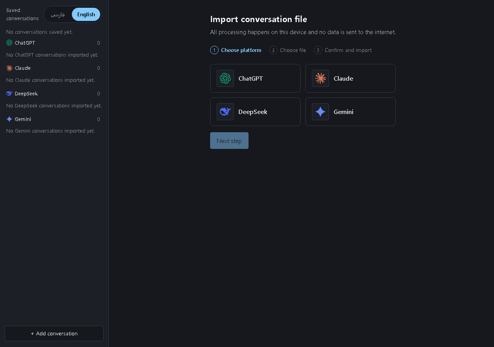
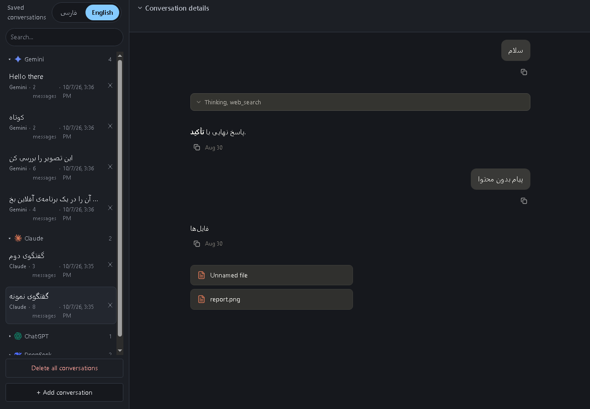

# Offline AI Conversation Viewer

[فارسی 🇮🇷](./README.fa.md)

A **fully offline** web app to import, locally store, and authentically render conversations exported from AI chat platforms — no backend, no uploads, no network requests of any kind.

Open the raw JSON file exported from an AI chat platform and browse it with the same visual feel as the original platform (colors, typography, message bubbles, icons) — like a personal library of your conversations.

---

## ⚠️ Project Status

This project was built **unit-by-unit** using Spec-Driven Development. Every unit (import, detection, parsing, library, metadata, theme rendering, search, and support for four platforms) is **complete and tested** — ChatGPT has a full parser and theme, but built on synthetic fixtures, so it remains **Unverified** until tested against a real export:

| Platform | Parser | Dedicated theme | Status |
|---|---|---|---|
| **DeepSeek** | ✅ | ✅ | Fully supported |
| **Claude** | ✅ | ✅ | Fully supported |
| **Gemini** | ✅ | ✅ | Fully supported |
| **ChatGPT** | ✅ | ✅ | Supported, but **Unverified** (not yet tested against a real export) |

**Why is ChatGPT Unverified?** This project takes "never guess a platform's data structure or appearance" seriously. The DeepSeek, Claude, and Gemini parsers and themes were built from real exports; ChatGPT is currently covered only by synthetic fixtures derived from the owner's description, and stays **Unverified** until tested against a real export. Adding a new platform never changes the existing architecture — it only adds a new module (see "Adding a new platform" below).

---

## ✨ Features

- **Automatic, zero-interaction import** — drag & drop or pick a JSON file; the source platform is detected fully automatically (no manual selection).
- **Persistent local library** — conversations are stored in the browser's IndexedDB and survive between visits; no need to re-import.
- **Smart duplicate detection** — re-importing a file never creates a duplicate record; it just shows a summary.
- **Authentic per-platform rendering** — the visual appearance (layout, color, font, message bubbles) reproduces the original platform, without copying any official code or asset.
- **Metadata panel** — title, date, and message count per conversation (when present in the source file).
- **Global search** — search across the title and text of every stored conversation, with no network requests.
- **Complete privacy** — no data ever leaves your browser.

---

## 📸 Screenshots

| Library | Conversation |
|---|---|
|  |  |

---

## 🚫 Out of Scope

- Editing or sending new messages (this is a **viewer** only, not a chat client)
- Re-exporting or format conversion
- Any server, API, or internet connection
- Authentication or user accounts
- Non-JSON formats (HTML, ZIP) — for now

---

## 🛠️ Tech Stack

| Layer | Technology |
|---|---|
| Language | TypeScript |
| UI Framework | React |
| Build Tool | Vite |
| Local Storage | IndexedDB (via Dexie.js) |
| Styling | CSS Modules + CSS Custom Properties |
| Testing | Vitest + React Testing Library |
| Lint / Format | ESLint + Prettier |

The project has **no backend**; the build output is fully static and can run on any static host (or even as local files).

---

## 🚀 Quick Start

```bash
# Install dependencies
npm install

# Run the dev server
npm run dev

# Run tests
npm run test

# Lint
npm run lint

# Build for production (static)
npm run build
```

### How to use

1. Open a JSON export file from DeepSeek, Claude, Gemini, or ChatGPT, via the file picker or drag & drop.
2. The file is automatically validated, its platform detected, and it's added to the library.
3. Pick a conversation from the sidebar to view it in that platform's authentic look.
4. Use the search bar at the top of the sidebar to find a specific conversation.

---

## 🏗️ Architecture (summary)

```
src/
├── parsers/{provider}/   — an independent module per platform (deepseek, claude, gemini, chatgpt)
├── detection/            — automatic platform detection from JSON structure (central registry)
├── normalization/        — converts each parser's output to the shared UnifiedConversation model
├── storage/              — the only layer allowed to talk to Dexie/IndexedDB directly
├── themes/{provider}/    — per-platform visual tokens and components (deepseek, claude, gemini, chatgpt)
├── components/           — shared components (sidebar, search, metadata panel)
├── features/             — feature orchestration (import, library, search)
├── types/                — shared data model and interfaces
└── workers/              — a Web Worker for parsing without blocking the UI
```

Full data flow:

```
User's file → Web Worker (parse) → Detection (platform recognition) → matching parser
  → Normalization (conversion to shared model) → Storage (IndexedDB) → UI (sidebar + theme)
```

No point in this flow ever touches the network. Full architecture details, design decisions (ADRs), and project invariants are documented in `context/architecture.md` and `context/progress-tracker.md`.

---

## ➕ Adding Support for a New Platform

The architecture is deliberately designed so adding a new platform (say, a fifth one) makes **no changes to existing platforms' code**. Steps:

1. Get a real, anonymized export sample from the target platform.
2. Create a new module under `src/parsers/{provider}/` (`detect()` + `parse()`).
3. Write a normalizer in `src/normalization/{provider}.ts` to convert to `UnifiedConversation`.
4. Register the module in `src/detection/registry.ts`.
5. Take screenshots of that platform's real UI and document the exact values (color, font, spacing) in `context/ui-context.md`.
6. Build a theme under `src/themes/{provider}/` based on that documentation.

A full step-by-step guide is available in `docs/parsers.md`.

---

## 📚 Project Documentation

| File | Content |
|---|---|
| `context/project-overview.md` | Goal, scope, features, deliverables |
| `context/architecture.md` | Stack, architecture, storage model, invariants |
| `context/ui-context.md` | Each platform's theme, colors, typography, layout |
| `context/code-standards.md` | Coding and testing standards |
| `context/progress-tracker.md` | Full decision history (ADRs) and project progress |
| `docs/parsers.md` | Guide for adding a parser for a new platform |

---

## ⚠️ Known Limitations (v1)

- Search doesn't normalize visually-similar Persian/Arabic characters (e.g. ی/ي or ک/ك) — search must match the exact character used in the source text.
- Only JSON is supported; HTML or ZIP files are not accepted in this version.
- Storage capacity depends on your browser's quota limit.

---

## 📄 License

MIT — see [LICENSE](./LICENSE). Copyright (c) 2026 M...D.
